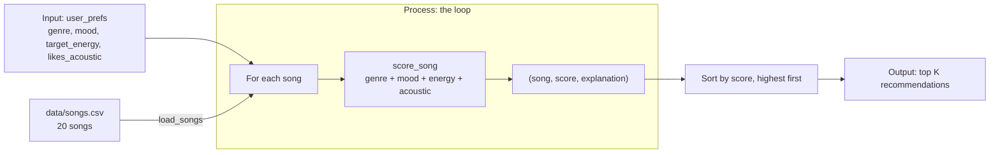

# 🎵 Music Recommender Simulation

## Project Summary

In this project you will build and explain a small music recommender system.

Your goal is to:

- Represent songs and a user "taste profile" as data
- Design a scoring rule that turns that data into recommendations
- Evaluate what your system gets right and wrong
- Reflect on how this mirrors real world AI recommenders

Replace this paragraph with your own summary of what your version does.

---

## How The System Works

Real-world platforms like Spotify and TikTok combine two approaches. **Collaborative filtering** recommends what similar users liked, learned from behavior such as plays, skips, likes and playlist adds. **Content-based filtering** recommends songs whose attributes (genre, mood, energy, tempo, and so on) match what a user already enjoys. Most production systems are hybrids: they score many candidate songs, then rank and re-rank them into a feed. My simulation is a **content-based** recommender, since it has song attributes but no data from other users. It puts the user's **genre** first, as a stable long-term taste; **mood** second, as what they want right now; and closeness to their preferred **energy** level third. The goal is for songs that _match_ the user's taste to rank highest, rather than songs that are simply louder or calmer. I left out tempo and danceability because in this dataset they closely follow energy (correlations of 0.96 and 0.86), so they would mostly count the same signal again.

**`Song` features used in scoring**

- `genre`: categorical, exact match with the user's favorite
- `mood`: categorical, exact match with the user's favorite
- `energy`: 0–1, scored by closeness to the user's target
- `acousticness`: 0–1, scored according to whether the user likes acoustic music

(`id`, `title` and `artist` identify the song; `tempo_bpm`, `valence` and `danceability` are loaded but not scored.)

**`UserProfile` features**

- `favorite_genre`: e.g. `"lofi"`
- `favorite_mood`: e.g. `"chill"`
- `target_energy`: preferred energy level from 0 to 1, e.g. `0.40`
- `likes_acoustic`: `True` / `False`

**Example taste profile** (in `src/main.py`), a late-night study listener:

```python
user_prefs = {
    "favorite_genre": "lofi",
    "favorite_mood": "chill",
    "target_energy": 0.40,
    "likes_acoustic": True,
}
```

When I tested this profile against the 20-song catalog, it clearly tells "chill lofi" from "intense rock." _Library Rain_ (lofi/chill) scores 4.85, while _Storm Runner_ (rock/intense) scores 0.79. A matching rock profile (`rock`, `intense`, `0.90`, `False`) gives the reverse result, with _Storm Runner_ at 4.93.

**Algorithm recipe (scoring rule for one song, max 5.0 points)**

| Part             | Points                                                                |
| ---------------- | --------------------------------------------------------------------- |
| Genre match      | +2.0                                                                  |
| Mood match       | +1.0                                                                  |
| Energy closeness | 1.5 × (1 − \|song.energy − target_energy\|)                           |
| Acoustic fit     | 0.5 × acousticness if `likes_acoustic`, else 0.5 × (1 − acousticness) |

**Ranking rule (whole catalog)**: score every song, sort from highest to lowest score, break ties consistently, and return the top _k_.

**Data flow**



**Expected biases and limitations**

- **Genre dominates.** A genre match (+2.0) outweighs a perfect mood and energy match combined. Great songs from a neighboring genre can get buried: a pop fan gets no genre credit for an "indie pop" song.
- **Exact string matching is brittle.** "chill" and "relaxed," or "pop" and "indie pop," count as complete mismatches.
- **Small genre groups.** Most genres have only one song. After that song, a rock fan's list is decided almost entirely by energy, and positions 3–5 are near-ties (1.89–1.91).
- **Mood is ignored unless it matches exactly.** _Rainy Window_ (blues/sad) ranks 6th for the chill lofi listener simply because its energy and acousticness are close.
- **One fixed taste.** The profile holds one genre and one mood, so it can't represent someone who likes both lofi and jazz, or whose mood changes over the day.
- **No discovery.** As a purely content-based system, it keeps recommending more of the same and never surprises the user the way collaborative filtering can.

---

## Getting Started

### Setup

1. Create a virtual environment (optional but recommended):

   ```bash
   python -m venv .venv
   source .venv/bin/activate      # Mac or Linux
   .venv\Scripts\activate         # Windows

   ```

2. Install dependencies

```bash
pip install -r requirements.txt
```

3. Run the app:

```bash
python -m src.main
```

### Running Tests

Run the starter tests with:

```bash
pytest
```

You can add more tests in `tests/test_recommender.py`.

---

## Sample Recommendation Output

Output of `python -m src.main`, which runs the recommender for three standard taste profiles and five adversarial / edge-case profiles (top 5 songs each).

### Standard profiles

#### High-Energy Pop

Clear pop/happy taste. Gym Hero lands at #2 on the genre match alone, despite an "intense" mood.

```text
================================================================
               MUSIC RECOMMENDER - High-Energy Pop
================================================================
  Listener profile:
    Genre ........ pop
    Mood ......... happy
    Energy ....... 0.85
    Acoustic ..... no
================================================================

  #1  Sunrise City  -  Neon Echo
      pop / happy
      Score: 4.87 / 5.00  [###################-]
      Why:
        + genre match: pop (+2.0)
        + mood match: happy (+1.0)
        + energy 0.82 vs target 0.85 (+1.46)
        + non-acoustic sound, acousticness 0.18 (+0.41)
  --------------------------------------------------------------

  #2  Gym Hero  -  Max Pulse
      pop / intense
      Score: 3.85 / 5.00  [###############-----]
      Why:
        + genre match: pop (+2.0)
        + energy 0.93 vs target 0.85 (+1.38)
        + non-acoustic sound, acousticness 0.05 (+0.47)
  --------------------------------------------------------------

  #3  Rooftop Lights  -  Indigo Parade
      indie pop / happy
      Score: 2.69 / 5.00  [###########---------]
      Why:
        + mood match: happy (+1.0)
        + energy 0.76 vs target 0.85 (+1.36)
        + non-acoustic sound, acousticness 0.35 (+0.33)
  --------------------------------------------------------------

  #4  Neon Petals  -  Kaori Sky
      k-pop / energetic
      Score: 1.90 / 5.00  [########------------]
      Why:
        + energy 0.88 vs target 0.85 (+1.46)
        + non-acoustic sound, acousticness 0.12 (+0.44)
  --------------------------------------------------------------

  #5  Storm Runner  -  Voltline
      rock / intense
      Score: 1.86 / 5.00  [#######-------------]
      Why:
        + energy 0.91 vs target 0.85 (+1.41)
        + non-acoustic sound, acousticness 0.10 (+0.45)
  --------------------------------------------------------------
```

#### Chill Lofi

The two lofi/chill songs are nearly tied; acousticness breaks the tie.

```text
================================================================
                  MUSIC RECOMMENDER - Chill Lofi
================================================================
  Listener profile:
    Genre ........ lofi
    Mood ......... chill
    Energy ....... 0.40
    Acoustic ..... yes
================================================================

  #1  Library Rain  -  Paper Lanterns
      lofi / chill
      Score: 4.85 / 5.00  [###################-]
      Why:
        + genre match: lofi (+2.0)
        + mood match: chill (+1.0)
        + energy 0.35 vs target 0.40 (+1.42)
        + acoustic sound, acousticness 0.86 (+0.43)
  --------------------------------------------------------------

  #2  Midnight Coding  -  LoRoom
      lofi / chill
      Score: 4.82 / 5.00  [###################-]
      Why:
        + genre match: lofi (+2.0)
        + mood match: chill (+1.0)
        + energy 0.42 vs target 0.40 (+1.47)
        + acoustic sound, acousticness 0.71 (+0.35)
  --------------------------------------------------------------

  #3  Focus Flow  -  LoRoom
      lofi / focused
      Score: 3.89 / 5.00  [################----]
      Why:
        + genre match: lofi (+2.0)
        + energy 0.40 vs target 0.40 (+1.50)
        + acoustic sound, acousticness 0.78 (+0.39)
  --------------------------------------------------------------

  #4  Spacewalk Thoughts  -  Orbit Bloom
      ambient / chill
      Score: 2.78 / 5.00  [###########---------]
      Why:
        + mood match: chill (+1.0)
        + energy 0.28 vs target 0.40 (+1.32)
        + acoustic sound, acousticness 0.92 (+0.46)
  --------------------------------------------------------------

  #5  Coffee Shop Stories  -  Slow Stereo
      jazz / relaxed
      Score: 1.90 / 5.00  [########------------]
      Why:
        + energy 0.37 vs target 0.40 (+1.46)
        + acoustic sound, acousticness 0.89 (+0.45)
  --------------------------------------------------------------
```

#### Deep Intense Rock

Only one rock song exists, so scores drop sharply after #1 (4.93 → 2.93).

```text
================================================================
              MUSIC RECOMMENDER - Deep Intense Rock
================================================================
  Listener profile:
    Genre ........ rock
    Mood ......... intense
    Energy ....... 0.90
    Acoustic ..... no
================================================================

  #1  Storm Runner  -  Voltline
      rock / intense
      Score: 4.93 / 5.00  [####################]
      Why:
        + genre match: rock (+2.0)
        + mood match: intense (+1.0)
        + energy 0.91 vs target 0.90 (+1.48)
        + non-acoustic sound, acousticness 0.10 (+0.45)
  --------------------------------------------------------------

  #2  Gym Hero  -  Max Pulse
      pop / intense
      Score: 2.93 / 5.00  [############--------]
      Why:
        + mood match: intense (+1.0)
        + energy 0.93 vs target 0.90 (+1.46)
        + non-acoustic sound, acousticness 0.05 (+0.47)
  --------------------------------------------------------------

  #3  Festival Heat  -  Pulse Theory
      edm / euphoric
      Score: 1.91 / 5.00  [########------------]
      Why:
        + energy 0.95 vs target 0.90 (+1.43)
        + non-acoustic sound, acousticness 0.03 (+0.48)
  --------------------------------------------------------------

  #4  Neon Petals  -  Kaori Sky
      k-pop / energetic
      Score: 1.91 / 5.00  [########------------]
      Why:
        + energy 0.88 vs target 0.90 (+1.47)
        + non-acoustic sound, acousticness 0.12 (+0.44)
  --------------------------------------------------------------

  #5  Iron Tide  -  Black Meridian
      metal / angry
      Score: 1.89 / 5.00  [########------------]
      Why:
        + energy 0.97 vs target 0.90 (+1.40)
        + non-acoustic sound, acousticness 0.02 (+0.49)
  --------------------------------------------------------------
```

### Adversarial / edge-case profiles

#### EDGE: Energetic but Sad

Conflicting preferences. Rainy Window wins on genre + mood (3.0 pts) even though its energy (0.40) is far from the 0.90 target; the categorical weights overpower energy.

```text
================================================================
           MUSIC RECOMMENDER - EDGE: Energetic but Sad
================================================================
  Listener profile:
    Genre ........ blues
    Mood ......... sad
    Energy ....... 0.90
    Acoustic ..... no
================================================================

  #1  Rainy Window  -  Sol Avery
      blues / sad
      Score: 3.88 / 5.00  [################----]
      Why:
        + genre match: blues (+2.0)
        + mood match: sad (+1.0)
        + energy 0.40 vs target 0.90 (+0.75)
        + non-acoustic sound, acousticness 0.75 (+0.12)
  --------------------------------------------------------------

  #2  Storm Runner  -  Voltline
      rock / intense
      Score: 1.93 / 5.00  [########------------]
      Why:
        + energy 0.91 vs target 0.90 (+1.48)
        + non-acoustic sound, acousticness 0.10 (+0.45)
  --------------------------------------------------------------

  #3  Gym Hero  -  Max Pulse
      pop / intense
      Score: 1.93 / 5.00  [########------------]
      Why:
        + energy 0.93 vs target 0.90 (+1.46)
        + non-acoustic sound, acousticness 0.05 (+0.47)
  --------------------------------------------------------------

  #4  Festival Heat  -  Pulse Theory
      edm / euphoric
      Score: 1.91 / 5.00  [########------------]
      Why:
        + energy 0.95 vs target 0.90 (+1.43)
        + non-acoustic sound, acousticness 0.03 (+0.48)
  --------------------------------------------------------------

  #5  Neon Petals  -  Kaori Sky
      k-pop / energetic
      Score: 1.91 / 5.00  [########------------]
      Why:
        + energy 0.88 vs target 0.90 (+1.47)
        + non-acoustic sound, acousticness 0.12 (+0.44)
  --------------------------------------------------------------
```

#### EDGE: Unknown Genre/Mood

No song can match "opera" or "triumphant", so ranking falls back to energy + acousticness and the top 5 are almost tied (1.70–1.75).

```text
================================================================
           MUSIC RECOMMENDER - EDGE: Unknown Genre/Mood
================================================================
  Listener profile:
    Genre ........ opera
    Mood ......... triumphant
    Energy ....... 0.50
    Acoustic ..... yes
================================================================

  #1  Coffee Shop Stories  -  Slow Stereo
      jazz / relaxed
      Score: 1.75 / 5.00  [#######-------------]
      Why:
        + energy 0.37 vs target 0.50 (+1.30)
        + acoustic sound, acousticness 0.89 (+0.45)
  --------------------------------------------------------------

  #2  Focus Flow  -  LoRoom
      lofi / focused
      Score: 1.74 / 5.00  [#######-------------]
      Why:
        + energy 0.40 vs target 0.50 (+1.35)
        + acoustic sound, acousticness 0.78 (+0.39)
  --------------------------------------------------------------

  #3  Midnight Coding  -  LoRoom
      lofi / chill
      Score: 1.73 / 5.00  [#######-------------]
      Why:
        + energy 0.42 vs target 0.50 (+1.38)
        + acoustic sound, acousticness 0.71 (+0.35)
  --------------------------------------------------------------

  #4  Rainy Window  -  Sol Avery
      blues / sad
      Score: 1.73 / 5.00  [#######-------------]
      Why:
        + energy 0.40 vs target 0.50 (+1.35)
        + acoustic sound, acousticness 0.75 (+0.38)
  --------------------------------------------------------------

  #5  Library Rain  -  Paper Lanterns
      lofi / chill
      Score: 1.70 / 5.00  [#######-------------]
      Why:
        + energy 0.35 vs target 0.50 (+1.27)
        + acoustic sound, acousticness 0.86 (+0.43)
  --------------------------------------------------------------
```

#### EDGE: Acoustic Metalhead

Contradictory taste. The acoustic preference barely matters (+0.01 to +0.06) because no loud song is acoustic.

```text
================================================================
           MUSIC RECOMMENDER - EDGE: Acoustic Metalhead
================================================================
  Listener profile:
    Genre ........ metal
    Mood ......... angry
    Energy ....... 0.95
    Acoustic ..... yes
================================================================

  #1  Iron Tide  -  Black Meridian
      metal / angry
      Score: 4.48 / 5.00  [##################--]
      Why:
        + genre match: metal (+2.0)
        + mood match: angry (+1.0)
        + energy 0.97 vs target 0.95 (+1.47)
        + acoustic sound, acousticness 0.02 (+0.01)
  --------------------------------------------------------------

  #2  Festival Heat  -  Pulse Theory
      edm / euphoric
      Score: 1.51 / 5.00  [######--------------]
      Why:
        + energy 0.95 vs target 0.95 (+1.50)
        + acoustic sound, acousticness 0.03 (+0.01)
  --------------------------------------------------------------

  #3  Gym Hero  -  Max Pulse
      pop / intense
      Score: 1.50 / 5.00  [######--------------]
      Why:
        + energy 0.93 vs target 0.95 (+1.47)
        + acoustic sound, acousticness 0.05 (+0.03)
  --------------------------------------------------------------

  #4  Storm Runner  -  Voltline
      rock / intense
      Score: 1.49 / 5.00  [######--------------]
      Why:
        + energy 0.91 vs target 0.95 (+1.44)
        + acoustic sound, acousticness 0.10 (+0.05)
  --------------------------------------------------------------

  #5  Neon Petals  -  Kaori Sky
      k-pop / energetic
      Score: 1.46 / 5.00  [######--------------]
      Why:
        + energy 0.88 vs target 0.95 (+1.40)
        + acoustic sound, acousticness 0.12 (+0.06)
  --------------------------------------------------------------
```

#### EDGE: Energy Out of Range (1.5)

Target energy is outside the 0–1 scale and is not validated. Every song loses energy points; very quiet songs would get negative energy points.

```text
================================================================
       MUSIC RECOMMENDER - EDGE: Energy Out of Range (1.5)
================================================================
  Listener profile:
    Genre ........ edm
    Mood ......... euphoric
    Energy ....... 1.50
    Acoustic ..... no
================================================================

  #1  Festival Heat  -  Pulse Theory
      edm / euphoric
      Score: 4.16 / 5.00  [#################---]
      Why:
        + genre match: edm (+2.0)
        + mood match: euphoric (+1.0)
        + energy 0.95 vs target 1.50 (+0.67)
        + non-acoustic sound, acousticness 0.03 (+0.48)
  --------------------------------------------------------------

  #2  Iron Tide  -  Black Meridian
      metal / angry
      Score: 1.19 / 5.00  [#####---------------]
      Why:
        + energy 0.97 vs target 1.50 (+0.70)
        + non-acoustic sound, acousticness 0.02 (+0.49)
  --------------------------------------------------------------

  #3  Gym Hero  -  Max Pulse
      pop / intense
      Score: 1.12 / 5.00  [####----------------]
      Why:
        + energy 0.93 vs target 1.50 (+0.65)
        + non-acoustic sound, acousticness 0.05 (+0.47)
  --------------------------------------------------------------

  #4  Storm Runner  -  Voltline
      rock / intense
      Score: 1.06 / 5.00  [####----------------]
      Why:
        + energy 0.91 vs target 1.50 (+0.61)
        + non-acoustic sound, acousticness 0.10 (+0.45)
  --------------------------------------------------------------

  #5  Neon Petals  -  Kaori Sky
      k-pop / energetic
      Score: 1.01 / 5.00  [####----------------]
      Why:
        + energy 0.88 vs target 1.50 (+0.57)
        + non-acoustic sound, acousticness 0.12 (+0.44)
  --------------------------------------------------------------
```

#### EDGE: Messy Casing / Near-Miss

Casing and whitespace are normalized correctly, but genre needs an exact match, so plain "pop" (Sunrise City) gets no genre credit.

```text
================================================================
        MUSIC RECOMMENDER - EDGE: Messy Casing / Near-Miss
================================================================
  Listener profile:
    Genre ........   Indie POP
    Mood ......... HAPPY
    Energy ....... 0.80
    Acoustic ..... no
================================================================

  #1  Rooftop Lights  -  Indigo Parade
      indie pop / happy
      Score: 4.76 / 5.00  [###################-]
      Why:
        + genre match: indie pop (+2.0)
        + mood match: happy (+1.0)
        + energy 0.76 vs target 0.80 (+1.44)
        + non-acoustic sound, acousticness 0.35 (+0.33)
  --------------------------------------------------------------

  #2  Sunrise City  -  Neon Echo
      pop / happy
      Score: 2.88 / 5.00  [############--------]
      Why:
        + mood match: happy (+1.0)
        + energy 0.82 vs target 0.80 (+1.47)
        + non-acoustic sound, acousticness 0.18 (+0.41)
  --------------------------------------------------------------

  #3  Concrete Crown  -  Kid Static
      hip-hop / confident
      Score: 1.93 / 5.00  [########------------]
      Why:
        + energy 0.78 vs target 0.80 (+1.47)
        + non-acoustic sound, acousticness 0.08 (+0.46)
  --------------------------------------------------------------

  #4  Neon Petals  -  Kaori Sky
      k-pop / energetic
      Score: 1.82 / 5.00  [#######-------------]
      Why:
        + energy 0.88 vs target 0.80 (+1.38)
        + non-acoustic sound, acousticness 0.12 (+0.44)
  --------------------------------------------------------------

  #5  Night Drive Loop  -  Neon Echo
      synthwave / moody
      Score: 1.81 / 5.00  [#######-------------]
      Why:
        + energy 0.75 vs target 0.80 (+1.42)
        + non-acoustic sound, acousticness 0.22 (+0.39)
  --------------------------------------------------------------
```

---

## Experiments You Tried

Use this section to document the experiments you ran. For example:

- What happened when you changed the weight on genre from 2.0 to 0.5
- What happened when you added tempo or valence to the score
- How did your system behave for different types of users

---

## Limitations and Risks

Summarize some limitations of your recommender.

Examples:

- It only works on a tiny catalog
- It does not understand lyrics or language
- It might over favor one genre or mood

You will go deeper on this in your model card.

---

## Reflection

Read and complete `model_card.md`:

[**Model Card**](model_card.md)

Write 1 to 2 paragraphs here about what you learned:

- about how recommenders turn data into predictions
- about where bias or unfairness could show up in systems like this
