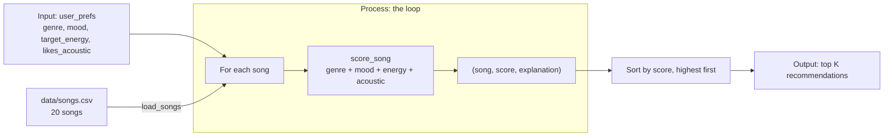

# 🎵 Music Recommender Simulation

## Project Summary

In this project you will build and explain a small music recommender system.

Your goal is to:

- Represent songs and a user "taste profile" as data
- Design a scoring rule that turns that data into recommendations
- Evaluate what your system gets right and wrong
- Reflect on how this mirrors real world AI recommenders

Replace this paragraph with your own summary of what your version does.

---

## How The System Works

Real-world platforms like Spotify and TikTok combine two approaches. **Collaborative filtering** recommends what similar users liked, learned from behavior such as plays, skips, likes and playlist adds. **Content-based filtering** recommends songs whose attributes (genre, mood, energy, tempo, and so on) match what a user already enjoys. Most production systems are hybrids: they score many candidate songs, then rank and re-rank them into a feed. My simulation is a **content-based** recommender, since it has song attributes but no data from other users. It puts the user's **genre** first, as a stable long-term taste; **mood** second, as what they want right now; and closeness to their preferred **energy** level third. The goal is for songs that _match_ the user's taste to rank highest, rather than songs that are simply louder or calmer. I left out tempo and danceability because in this dataset they closely follow energy (correlations of 0.96 and 0.86), so they would mostly count the same signal again.

**`Song` features used in scoring**

- `genre`: categorical, exact match with the user's favorite
- `mood`: categorical, exact match with the user's favorite
- `energy`: 0–1, scored by closeness to the user's target
- `acousticness`: 0–1, scored according to whether the user likes acoustic music

(`id`, `title` and `artist` identify the song; `tempo_bpm`, `valence` and `danceability` are loaded but not scored.)

**`UserProfile` features**

- `favorite_genre`: e.g. `"lofi"`
- `favorite_mood`: e.g. `"chill"`
- `target_energy`: preferred energy level from 0 to 1, e.g. `0.40`
- `likes_acoustic`: `True` / `False`

**Example taste profile** (in `src/main.py`), a late-night study listener:

```python
user_prefs = {
    "favorite_genre": "lofi",
    "favorite_mood": "chill",
    "target_energy": 0.40,
    "likes_acoustic": True,
}
```

When I tested this profile against the 20-song catalog, it clearly tells "chill lofi" from "intense rock." _Library Rain_ (lofi/chill) scores 4.85, while _Storm Runner_ (rock/intense) scores 0.79. A matching rock profile (`rock`, `intense`, `0.90`, `False`) gives the reverse result, with _Storm Runner_ at 4.93.

**Algorithm recipe (scoring rule for one song, max 5.0 points)**

| Part             | Points                                                                |
| ---------------- | --------------------------------------------------------------------- |
| Genre match      | +2.0                                                                  |
| Mood match       | +1.0                                                                  |
| Energy closeness | 1.5 × (1 − \|song.energy − target_energy\|)                           |
| Acoustic fit     | 0.5 × acousticness if `likes_acoustic`, else 0.5 × (1 − acousticness) |

**Ranking rule (whole catalog)**: score every song, sort from highest to lowest score, break ties consistently, and return the top _k_.

**Data flow**



**Expected biases and limitations**

- **Genre dominates.** A genre match (+2.0) outweighs a perfect mood and energy match combined. Great songs from a neighboring genre can get buried: a pop fan gets no genre credit for an "indie pop" song.
- **Exact string matching is brittle.** "chill" and "relaxed," or "pop" and "indie pop," count as complete mismatches.
- **Small genre groups.** Most genres have only one song. After that song, a rock fan's list is decided almost entirely by energy, and positions 3–5 are near-ties (1.89–1.91).
- **Mood is ignored unless it matches exactly.** _Rainy Window_ (blues/sad) ranks 6th for the chill lofi listener simply because its energy and acousticness are close.
- **One fixed taste.** The profile holds one genre and one mood, so it can't represent someone who likes both lofi and jazz, or whose mood changes over the day.
- **No discovery.** As a purely content-based system, it keeps recommending more of the same and never surprises the user the way collaborative filtering can.

---

## Getting Started

### Setup

1. Create a virtual environment (optional but recommended):

   ```bash
   python -m venv .venv
   source .venv/bin/activate      # Mac or Linux
   .venv\Scripts\activate         # Windows

   ```

2. Install dependencies

```bash
pip install -r requirements.txt
```

3. Run the app:

```bash
python -m src.main
```

### Running Tests

Run the starter tests with:

```bash
pytest
```

You can add more tests in `tests/test_recommender.py`.

---

## Sample Recommendation Output

Paste a sample of your recommender's output here as a text block so a reader can see what it produces:

```
================================================================
                  MUSIC RECOMMENDER - Top Picks
================================================================
  Listener profile:
    Genre ........ lofi
    Mood ......... chill
    Energy ....... 0.40
    Acoustic ..... yes
================================================================

  #1  Library Rain  -  Paper Lanterns
      lofi / chill
      Score: 4.85 / 5.00  [###################-]
      Why:
        + genre match: lofi (+2.0)
        + mood match: chill (+1.0)
        + energy 0.35 vs target 0.40 (+1.42)
        + acoustic sound, acousticness 0.86 (+0.43)
  --------------------------------------------------------------

  #2  Midnight Coding  -  LoRoom
      lofi / chill
      Score: 4.82 / 5.00  [###################-]
      Why:
        + genre match: lofi (+2.0)
        + mood match: chill (+1.0)
        + energy 0.42 vs target 0.40 (+1.47)
        + acoustic sound, acousticness 0.71 (+0.35)
  --------------------------------------------------------------

  #3  Focus Flow  -  LoRoom
      lofi / focused
      Score: 3.89 / 5.00  [################----]
      Why:
        + genre match: lofi (+2.0)
        + energy 0.40 vs target 0.40 (+1.50)
        + acoustic sound, acousticness 0.78 (+0.39)
  --------------------------------------------------------------

  #4  Spacewalk Thoughts  -  Orbit Bloom
      ambient / chill
      Score: 2.78 / 5.00  [###########---------]
      Why:
        + mood match: chill (+1.0)
        + energy 0.28 vs target 0.40 (+1.32)
        + acoustic sound, acousticness 0.92 (+0.46)
  --------------------------------------------------------------

  #5  Coffee Shop Stories  -  Slow Stereo
      jazz / relaxed
      Score: 1.90 / 5.00  [########------------]
      Why:
        + energy 0.37 vs target 0.40 (+1.46)
        + acoustic sound, acousticness 0.89 (+0.45)
  --------------------------------------------------------------
```

**Screenshot or video** _(optional)_: <!-- Insert a screenshot or demo video link here -->

---

## Experiments You Tried

Use this section to document the experiments you ran. For example:

- What happened when you changed the weight on genre from 2.0 to 0.5
- What happened when you added tempo or valence to the score
- How did your system behave for different types of users

---

## Limitations and Risks

Summarize some limitations of your recommender.

Examples:

- It only works on a tiny catalog
- It does not understand lyrics or language
- It might over favor one genre or mood

You will go deeper on this in your model card.

---

## Reflection

Read and complete `model_card.md`:

[**Model Card**](model_card.md)

Write 1 to 2 paragraphs here about what you learned:

- about how recommenders turn data into predictions
- about where bias or unfairness could show up in systems like this
